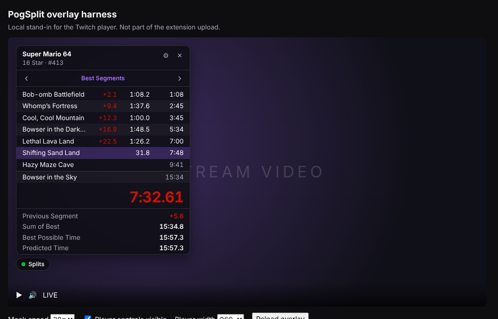

# PogSplit Twitch overlay (prototype)

A Twitch **video overlay** extension that shows the streamer's PogSplit (LiveSplit) run on top of the
stream. Each viewer decides what they see: splits, deltas, segment times, the timer, sum of
best and other stats, which comparison to measure against, where it sits (drag the title bar) and how big
it is (drag the corner grip; text and spacing scale with it). Those choices are saved in that viewer's browser only.



Until the streamer's PogSplit sends real data, the overlay plays a built-in demo run so it can
be tested anywhere.

```
twitch-extension/
  video_overlay.html        the extension's viewer page (Video - Fullscreen view)
  config.html               broadcaster config view: pair / disconnect PogSplit
  js/ebs.js                 POGSPLIT_EBS, the bridge backend URL (shared by both views)
  css/overlay.css
  js/model.js               run state + deltas, golds, sum of best, best possible time (no DOM)
  js/settings.js            per-viewer preferences (localStorage, fails safe)
  js/mock-feed.js           simulated attempts emitting real schema messages
  js/overlay.js             feed -> model -> DOM, viewer controls, Twitch helper hooks
  schema/run-state.schema.json   the message format PogSplit must send
  mock/sample-snapshot.json      example mid-run snapshot (1 KB)
  dev.html, js/dev.js, css/dev.css   local harness with a fake player (not uploaded)
  tools/send-pubsub.js      sends a message to a real channel through Extension PubSub
  docs/preview.png          screenshot
  test/model.test.js        model tests;  test/make-sample.js rebuilds the sample
```

## Try it locally (no Twitch account needed)

```sh
cd twitch-extension
npx http-server -p 8080 -c-1        # or: python -m http.server 8080
```

Open <http://localhost:8080/dev.html>. The harness puts the overlay over a fake player and lets
you speed up the demo run, hide the "player controls", change the player width, and paste a
schema message ("Load sample snapshot", then "Send") to see how the overlay switches to live
data.

Model tests: `node test/model.test.js`.

URL switches on `video_overlay.html`: `mock=0` disables the demo, `mock=1` forces it,
`speed=20` runs the demo 20× faster.

## What viewers can do

- **Splits** button (top of the overlay) shows or hides the whole panel. It fades out with
  Twitch's player controls so it never sits on the video when nobody is interacting.
- **‹ ›** switches comparison (Personal Best, Best Segments, Average Segments, or whatever the
  streamer's splits contain). Deltas, colors, previous segment and predictions all follow it.
  Viewers start on the streamer's current comparison.
- **⚙** toggles: splits, deltas, segment times, timer, previous segment, sum of best, best
  possible time, possible time save, predicted time; number of rows (5/8/12/all); position (a corner, or wherever it was dragged); delta
  decimals (default 1); time decimals for splits, timer and stats (default 2); size.
- **✕** collapses the panel back to the button.
- **Attempts / Finished / Golds** tabs (shown when the streamer shares their run history) list recent
  attempts and where they were reset, the last finished runs (click one for its split times) and
  the latest golds with how much they saved. The history is fetched from the EBS when a tab opens.

Colors follow LiveSplit's defaults: green ahead, red behind, lighter shades when the last
split gained back time, gold for a best segment.

## Message format

The overlay listens on `Twitch.ext.listen('broadcast', …)` and accepts the JSON in
`schema/run-state.schema.json`. All times are integer milliseconds.

- **snapshot**: game, category, attempts, comparison names, every segment
  (`name`, `best` gold time, `cmp` = cumulative time for each comparison), this attempt's
  `splits` so far, and `timer` (`phase`, `time`, `splitIndex`). Send on start, on reset, when a
  comparison changes (new PB, splits edited), and every ~15 s so late joiners catch up.
- **update**: only `splits`, optionally `best` (after a gold) and `attempts`, plus `timer`. Send
  on every split, undo, skip, pause and resume.

- **offline**: PogSplit stopped, which is sent by the bridge after 45s without a heartbeat. The overlay
  freezes the timer and says so.

Every message can also include:

- `seq`: a number that goes up by one with each message. If the overlay sees a number skipped,
  it knows it missed a message and fetches the full state again.
- `run`: a short fingerprint of the splits file. If it changes, the streamer switched or edited
  their splits, so the overlay fetches the full state again.
- `fx`: effects such as golds and PBs. These aren't used yet.

`timer.at` is the time on the streamer's PC when `timer.time` was read.

Twitch limits each broadcast message to 5 KB, so when the full state is too big, the overlay fetches it
from the backend instead (`GET /v1/channels/{id}/state`, sent with the viewer's Twitch login token).
The backend's address is set in `js/ebs.js`, and it must also be listed in the Twitch developer console
under **Capabilities → Allowlist for URL Fetching Domains**.

Viewers see the stream a few seconds behind real time, so the overlay holds each live message back by
that same delay. That way splits don't appear before they happen on the video.

The overlay runs the timer itself from `timer.time` while `phase` is `Running`, measured from
when the message arrived, so there's no per-frame traffic and viewer clock skew doesn't matter.
Deltas, sum of best and the rest are computed in the overlay, which is why a viewer can pick a
different comparison than the streamer.

Sizing: Twitch PubSub messages must be under 5 KB and a channel may send about 100 per minute.
An 11-split snapshot with three comparisons is ~1 KB, so roughly 50 splits with three comparisons
fit. Longer runs should send fewer comparisons.

## Testing with the Twitch Developer Rig

1. **Create the extension.** In the [Extensions console](https://dev.twitch.tv/console/extensions)
   create an extension, then under **Asset Hosting** set:
   - Type: **Video - Fullscreen**
   - Video - Fullscreen viewer path: `video_overlay.html`
   - Config path: `config.html` (under Capabilities, Configuration Service is not needed)
   - Testing Base URI: `http://localhost:8080/`
2. **Add it to the Rig.** Install and sign in to the
   [Developer Rig](https://dev.twitch.tv/docs/extensions/rig/), choose
   **Add project → Use an existing extension**, pick the extension and the version you just set
   up, and point the project folder at this `twitch-extension` folder.
3. **Serve the files.** In the Rig's Project Details, set the front-end folder to this folder
   and the front-end command to `npx http-server -p 8080 -c-1 --cors`, then press
   **Run Frontend**. (Running the same command in a terminal works too.)
4. **Make a view.** In **Extension Views → Create New View** choose **Video - Fullscreen**,
   viewer type *Logged-Out* or *Logged-In*, and a player size. The demo run starts straight
   away. Make a second view with a different size to check the panel in a small player.
5. **Check per-viewer toggles.** Change settings in one view and reload it; the choices stay.
   (Views in the Rig share one browser profile, so they share preferences too. On Twitch each
   viewer's browser keeps its own.)
6. **Send a live message (optional).** With the extension in *Local Test* and installed on your
   own channel, run:

   ```sh
   TWITCH_CLIENT_ID=… TWITCH_EXT_SECRET=… TWITCH_OWNER_ID=… TWITCH_CHANNEL_ID=… \
     node tools/send-pubsub.js mock/sample-snapshot.json
   ```

   The overlay in the Rig (or on your channel page) drops the demo and shows "Live from
   PogSplit". `TWITCH_OWNER_ID` is the extension owner's user id and `TWITCH_CHANNEL_ID` your
   channel's; the secret comes from **Extension Settings → Extension Secrets** and must never be
   committed or shipped in front-end code.

If the Rig isn't available on your machine, the same steps work without it: serve the folder
as in step 3, set the extension to **Local Test** in the console, install it on your channel
from **Creator Dashboard → Extensions**, activate it as an overlay and open your channel page.

**Hosted Test / review upload:** zip `video_overlay.html`, `config.html`, `css/overlay.css`,
`css/config.css` and `js/` except `js/dev.js`. Leave out `dev.html`, `test/`, `tools/`, `mock/` and `schema/`.

## Pairing PogSplit with a channel (config view)

The broadcaster opens the extension's settings on Twitch, which shows `config.html`. PogSplit's
**Connect to Twitch** shows a code like `KJ4M-29QX`; the broadcaster types it (dash and case
optional) and presses **Connect**, which calls `POST /v1/device/confirm` on the bridge with
their Twitch token. **Disconnect PogSplit** calls `DELETE /v1/channel/tokens`. Errors are
explained in plain words: a wrong or expired code, not the broadcaster, or the service
unreachable.

## Twitch constraints this respects

- The Extension Helper is loaded from Twitch's CDN; all other code and styles are local files,
  with no inline scripts (Twitch's CSP blocks them) and no remote fonts.
- The page background is transparent and only the panel takes clicks, so the rest of the video
  stays usable. Bottom-corner placements leave room for the player controls bar.
- Storage access is wrapped so the overlay still works where `localStorage` is blocked; it just
  forgets settings on reload.

## Not done yet

- **Turn off the demo before release.** When the streamer's PogSplit isn't sending anything, the
  overlay plays a fake demo run. Before the extension is public, the demo should be off by default
  (the same as adding `?mock=0` today), so viewers see "Waiting for the streamer's PogSplit" instead.
- **No streamer defaults.** The config page can only connect and disconnect PogSplit. Streamers
  can't yet pick defaults for their viewers, such as which corner the overlay starts in or which
  comparisons to share.
- **No real time or game time label.** The overlay shows whichever timing method the streamer's
  PogSplit is using, but doesn't say which one it is.
